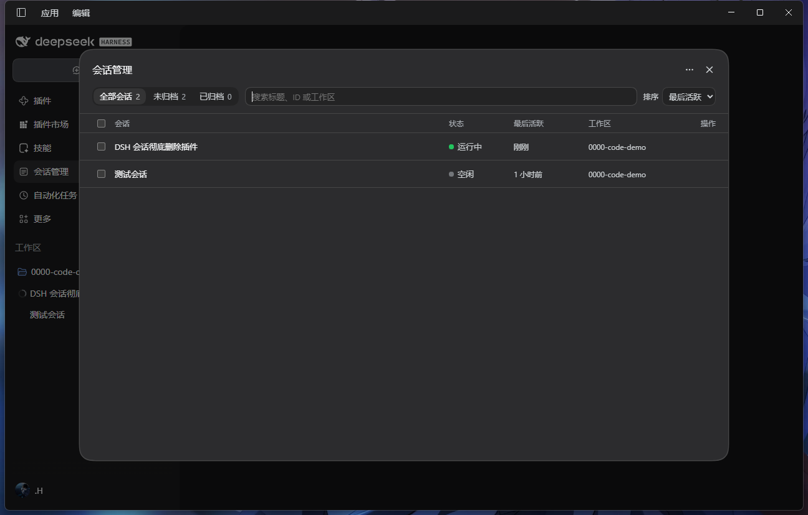

# dsh-session-manager

为 DSH（DeepSeek Harness）补上会话的「彻底删除」和一份集中管理的控制台。DSH 自带的「归档」只是把会话从列表里藏起来；这个插件把残留一起清掉，并提供一个可以筛选、排序、批量清理的页面。

> Purge DSH Sessions for good — and manage them from one console: filters, search, sort, bulk delete, with explicit guards before anything running gets killed.

- 包名 / Package: `@kissblank/dsh-session-manager`
- 兼容 / Requires: `dsh >= 0.2.0-rc.1 < 0.3.0-0`
- 许可证 / License: 保留所有权利，个人使用免费，见 [LICENSE](LICENSE) / All rights reserved, free for personal use — see [LICENSE](LICENSE)

---

## 中文

### 它能做什么

**1. 会话菜单里的「彻底删除…」**

点开任一会话行的菜单，最下面一行（垃圾桶图标、红色、上方有分隔线）可以删除**这一个**会话，删除前有确认弹窗。

**2. 侧边栏「会话管理」控制台**

侧边栏图标栏（「插件」「自动化任务」那一列）新增一个「会话管理」入口，点开是大尺寸独立页面：

- 顶部 Tab：**全部会话 / 未归档 / 已归档**，每个 Tab 带实时数量；
- 「全部」里已归档的会话灰化并带「已归档」徽标；
- 常驻搜索框（匹配标题 / 会话 ID / 工作区名）；
- 排序：最近活跃（默认）或创建时间；
- 每行：复选框、标题、状态点（运行中 / 等待交互 / 空闲）、相对时间（悬停显示绝对时间）、工作区；
- 行内悬停按钮：**取消归档**、**彻底删除**；
- 列表虚拟滚动，Tab 与排序会记住；
- 勾选后底部出现吸底栏：`已选 N 个`、**全选当前结果**、**批量彻底删除**；
- 切换 Tab 或改搜索词自动清空选择；
- 不同 Tab / 搜索无结果时有各自空状态文案。

**3. 控制台右上角 `⋯` 的清理菜单**

- **清理无主缓存**：删掉「对应的会话已经不存在」的投影缓存记录，并告诉你清理了几项、释放了多少空间；
- **清理空工作区目录**：删掉已经不包含任何会话的空工作区目录；
- **清理陈旧备份**：宿主写坏的存储备份（`workspace.json.bak-*`）里如果还留着已经删掉的会话 id，把它抹掉——文件保留，只去掉失效的 id。

三者都不会碰活着的会话：缓存清扫逐条比对仍在磁盘和内存里的会话，目录清扫只在目录确实为空时才删，备份清扫只删「宿主已经不认识的 id」。删除单个会话时不会顺带做这三件事——它们由你手动触发。

### 一次删除会删掉什么

1. **停止活动**：中断该会话正在跑的轮次、结束它的后台任务，等它真正静下来（最多 3 秒）；
2. **从所有窗口移除**：会话即时从每个窗口的列表里消失；
3. **清掉归属与标记**：从各工作区的会话列表中摘除，并清除它的归档、置顶记录；
4. **连带子会话**：递归找出它的所有子代理会话（含多级），一并按同样步骤处理——这些子会话的日志同样落在磁盘上，只删父会话会留下读不到的残骸；
5. **删除日志目录**：`<DSH_HOME>/sessions/<工作区>/<会话 id>/`，父会话与每个子会话各一份；
6. **删除投影缓存**：该会话及其子会话在 `storages/session_projcache` 下的缓存文件。

删除前会先让宿主把写缓冲落盘并释放文件句柄，避免 Windows 上「文件仍被占用」导致删一半；真遇到删不掉的目录，接口会把它列在 `leftovers` 里而不是假装成功。

**不会删**：工作区里的代码与文件、其他会话、跨会话共享的附件库、任何设置与凭据。

**没有回收站**——删了就是删了。磁盘未分配空间与你自己做的外部备份不在插件控制范围内；宿主自己保留的 `workspace.json.bak-*` 备份里的残留 id，可以用上面「清理陈旧备份」抹掉。

### 防误杀

- 选中项里**有正在运行的会话**时，确认弹窗会红字说明有几个正在运行，并出现复选框「**我确认强制中断这些运行中的任务**」——不勾选，红色确认按钮保持禁用；
- 一次删除超过 **10** 个会话时，还要勾「**我已知晓无法恢复**」；
- 确认后显示「正在停止任务 (i/n)」逐条进度，界面不会假死；
- 单条失败不中断整批，结束后汇总失败条目；成功的条目会统一刷新侧边栏与归档数据。

### 安装

在插件管理器的安装入口填下面任一写法：

- npm 包名：`@kissblank/dsh-session-manager`（可锁版本：`@kissblank/dsh-session-manager@1.0.1`）
- GitHub：`github:KissBlank/dsh-session-manager`（可锁 tag：`github:KissBlank/dsh-session-manager#v1.0.1`）
- 本地：填本仓库的绝对路径

1.0.0 起仓库名与 npm 包名统一为 `@kissblank/dsh-session-manager`，版本号也从 1.0.0 重新开始（更早的 0.x 版本与试验用的包名均已下线）。

装好（或换过包名）之后**重启 DSH 桌面端**，刷新页面不够——新装的插件要等宿主重新启动才会被加载。之后日常修改本仓库代码时，只改界面刷新页面即可，改到宿主侧逻辑则仍需重启。

### 兼容说明

删除要动的是宿主自己的数据，所以本插件用到了几个宿主提供的接口：`sessions.store` 里每个条目的 `detach()`、`sessionProjectionCache.table` 的 `keys()`/`delete()`、`workspaceRegistry` 实体的 `detachSession()`/`unarchiveSession()`/`unpinSession()`、`sessionPersistence.root` 与 `flush()`、以及 `sessionQuery.listSessions()`。这些都按 `dsh 0.2.1-rc.5` 实测行为实现，宿主升级后如果这些接口的形状变了，插件可能静默降级（例如缓存清扫返回 `projection-cache-unavailable`）。删目录这一步始终只依赖文件系统，不受影响。

### 许可

个人与组织内部使用免费：可以安装、使用、为了自用改源码。**未经作者事先书面许可，不得再分发本插件、也不得发布修改版或 fork**（为提交 PR 而建的 fork 可以，但不能单独对外发布），不得用于付费产品/服务，不得删除署名与版权声明。商业使用或二次发布请先联系作者。完整条款见 [LICENSE](LICENSE)。

---

## English

### What it does

- **Session menu → “Delete permanently…”**: destroys one Session from its row menu, behind a confirmation dialog.
- **Sessions console in the sidebar icon rail**: tabs with live counts (All / Active / Archived), archived rows dimmed and badged, debounced search, sorting by last activity or creation time, a virtualized list, per-row hover actions (unarchive / delete), and a sticky bulk bar with “Select all results”.
- **`⋯` menu in the console**: clear projection-cache records whose Session is gone, remove empty `sessions/<project>/` folders, and scrub dead Session ids out of stale `workspace.json.bak-*` backups. None of the three can touch a live Session — ids are compared against the Sessions still on disk and in memory, a folder is removed only after an empty listing, and a backup keeps every id the Host still knows.

### What a deletion touches

It stops the Session (its running turn and backend jobs, up to 3 s of settling), drops it from every window's list immediately, detaches it from each Workspace and clears its archive/pin records, follows its sub-agent Sessions to any depth and deletes those too, removes every log directory under `<DSH_HOME>/sessions/<project>/<id>/`, and deletes the projection-cache records of the whole family.

The Host is flushed before anything is unlinked, so Windows does not fail on a file still held open; a directory that could not be removed is reported back in `leftovers` instead of being counted as deleted.

Workspace files, other Sessions, the shared attachment store, settings and credentials are **not** touched. There is no trash: deletion is final, and any stale ids left in Host-owned `workspace.json.bak-*` backups can be scrubbed from the same `⋯` menu.

### Guards

If any selected Session is running, the dialog says how many, and its red confirm button stays disabled until you tick “I understand these running tasks will be interrupted”. More than 10 selections additionally require “I understand this cannot be undone”. Progress is reported per Session (“Stopping tasks (i/n)”), failures are collected instead of aborting the batch, and the sidebar refreshes once at the end.

### Install

Install through the plugin manager with any of these specs: `@kissblank/dsh-session-manager` (pin with `@1.0.2`), `github:KissBlank/dsh-session-manager` (pin with `#v1.0.2`), or a local absolute path. Then **restart the DSH desktop app** — a page reload is not enough, because the Host decides which plugins the browser loads when it starts. Afterwards, while working on this repository, UI changes come alive on a page reload and Host-side changes need a restart.

### Compatibility

Deleting touches the Host's own data, so this plugin reads a few interfaces the Host exposes: `detach()` on each `sessions.store` entry, `keys()`/`delete()` on `sessionProjectionCache.table`, `detachSession()`/`unarchiveSession()`/`unpinSession()` on a `workspaceRegistry` entity, `sessionPersistence.root` and `flush()`, and `sessionQuery.listSessions()`. All of it is implemented against `dsh 0.2.1-rc.5` as measured; if a later Host changes those shapes the plugin degrades instead of crashing (a cache sweep reports `projection-cache-unavailable`). Removing directories only relies on the filesystem and is unaffected.

### License

Free for personal and internal use: install it, use it, modify it for yourself. **You may not redistribute the plugin, or publish a modified version or fork, without the Author's prior written permission** (a fork opened to send a pull request is fine, but must not be published on its own); you may not use it in a paid product or service, and you may not strip the attribution or copyright notice. Contact the Author first for commercial use or redistribution. The full terms are in [LICENSE](LICENSE).

© 2026 Kiss_Blank — all rights reserved, see [LICENSE](LICENSE)
